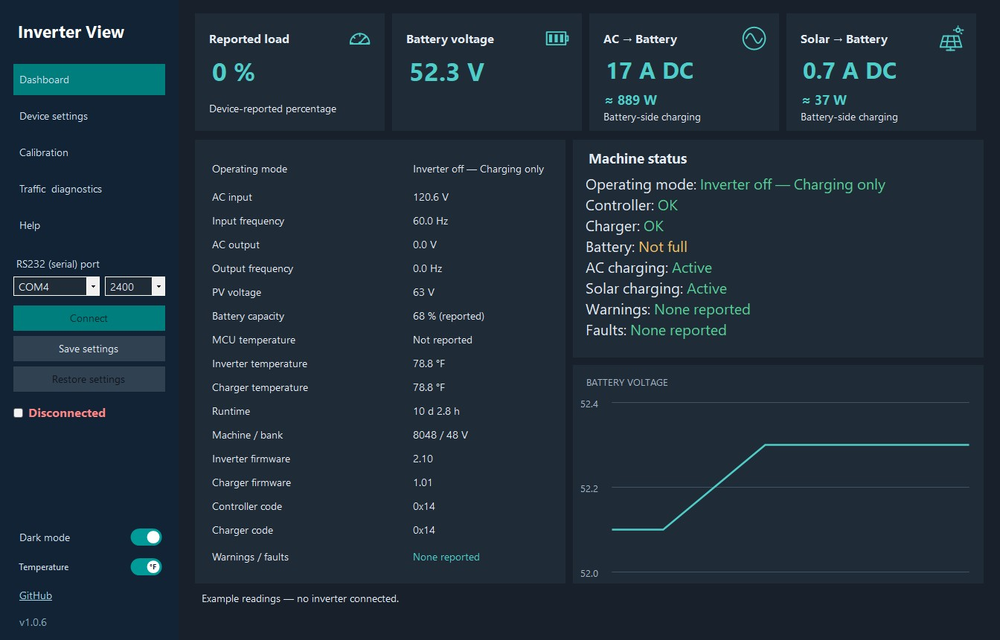

# Inverter View

**Language: C# · Windows Forms · .NET Framework 4.8.** Complete application source, tests and PowerShell build/package scripts are included. The optional command-line capture reader is Python.

Current version: **1.0.6**. See the dated [changelog](CHANGELOG.md) for changes between builds.

A Windows desktop app for monitoring and configuring inverters that use the **CMSG / VPHB V-Series serial protocol**. Extract the portable ZIP to a writable folder and run `InverterView.exe`. No installer, Python runtime, account, or application password is needed.



*Dashboard in dark mode with example readings; no inverter is connected in this screenshot. Light mode is also available.*

**Calibration is unresolved.** The original battery-voltage calibration command produced no observable effect on the tested inverter. The other five calibration writes have not been tested on hardware. They remain available as explicitly experimental commands so others can help investigate. Sending a packet is never reported as proof of acceptance.

## Download and run

Download [InverterView-1.0.6-portable.zip](dist/InverterView-1.0.6-portable.zip), extract it, and run `InverterView.exe`. The ZIP contains the executable, its runtime configuration, and documentation. Requires Windows with .NET Framework 4.8 and the USB-to-serial adapter's driver. The application runs with ordinary user privileges. Its executable is unsigned.

1. Stop the original monitoring program's serial connection.
2. Select the inverter's COM port. The tested connection uses **2400 baud, 8N1**, no flow control, DTR/RTS off.
3. Click **Connect**. The app sends only status requests until you explicitly apply a setting or command.
4. Review **Device settings**. Both groups show the current value alongside your proposed value. Amber marks pending edits; teal marks values that changed since connecting. Polling preserves your draft edits.
5. Select **°C** or **°F** for temperatures. This preference is saved beside the executable; it does not change the inverter.

All 20 normal settings are grouped in two columns, following the original utility's order. All six calibration controls have their own page. The **Dashboard** shows load, battery voltage and two charging cards. **AC → Battery** and **Solar → Battery** each show the DC amps supplied to the battery by that charger. The watts below each current are calculated from the battery voltage in the same reading and rounded to the nearest watt. For example, 52.3 V × 0.7 A displays as **≈ 37 W**. Machine status and the battery chart share the right-hand column equally. Hover over the chart for a voltage reading. The chart keeps the last 180 readings for the current connection.

**Inverter off — Charging only** means the inverter's AC output is off while solar or AC battery charging remains available. Machine status shows which charging sources are active separately.

Use the **Dark mode** switch beside the temperature switch, above GitHub in the lower sidebar. Light mode uses bold, darker text on a pale blue background. The theme and temperature unit are remembered. The indicator below **Restore settings** is green and checked while readings are fresh, and red and unchecked after disconnection or loss of fresh readings. The RS232 port list updates when opened or when connecting.

**Help** provides one basic settings guide based on the supplied operating manuals. Each settings group also has a Help button that opens the selected setting's explanation.

Battery voltage settings use **full-bank volts**. For the tested 48 V system, the reported bulk target is **56.4 V** and its permitted step is **0.4 V**. The reported output measurement and configured AC output target remain separate fields; the app does not infer or double a split-phase measurement.

## Inverters and RS-232 connection

The expected protocol is the **Techfine / V-Series CMSG / VPHB family** used by some rebadged all-in-one inverters. Compatibility depends on the actual protocol and firmware, not the brand name alone.

| Inverter / family | Compatibility status |
| --- | --- |
| **VEVOR VS8048AMN**, 48 V, machine 8048, inverter firmware 2.10 / charger 1.01 | Tested directly: live status and bulk-voltage write/readback |
| **Techfine V-Series** devices using the Runtime 001 / VPower utility and CMSG / VPHB protocol | Expected family; individual models and firmware still need validation |
| **PowMr POW-RELAB / SPLIT-series** and related boards | Candidates to investigate; this app has not been tested directly on these models. A [public PowMr-related capture](https://github.com/softwarecrash/Solar2MQTT-ESP8266/discussions/234) confirms related VPHB traffic with different firmware/frame length, not full settings compatibility |
| Other RS-232 inverters, including unrelated Modbus or QPIGS protocols | Not automatically compatible |

Use the inverter's **RS-232** communications port and the correct manufacturer cable/pinout, connected through a USB-to-RS232 adapter. A USB adapter appears as a Windows COM port. Do not substitute an RS-485 or TTL serial adapter; the connector shape alone does not identify the signal or pinout.

| Connection setting | Value |
| --- | --- |
| Baud rate | **2400 baud** |
| Data bits | **8** |
| Parity | **None** |
| Stop bits | **1** |
| Flow control | **None** (no RTS/CTS or XON/XOFF) |
| DTR / RTS | **Off** |
| Windows port | Select your adapter's COM port; **COM4** was used during this investigation |
| Status request / reply | `CMSG` with `INV-HB` payload / checksum-validated `VPHB` frames |

Stop the original utility's connection before connecting this app. The 4800 and 9600 choices are provided for devices configured differently; **2400 is the tested setting**. Other firmware requires explicit experimental write opt-in under Traffic & diagnostics. See [protocol details](docs/protocol.txt) for exact bytes and framing.

## Save and restore settings

1. Connect and click **Save settings** to save the reported values to a JSON file. Unapplied edits are not saved as device settings.
2. To restore, connect to the matching model, bank voltage and firmware, then click **Restore settings** and select that file.
3. Review **Current** and **Saved** values. Changed normal settings are selected; matching values are skipped. Experimental calibration values are unchecked until explicitly selected.
4. Click **Restore selected settings**. Each write receives the same three-readback verification as an individual edit.

If a step fails, the app tries to revert that step and stops the remaining changes. Earlier successful changes remain applied; the result reports partial completion. Closing or disconnecting stops before the next setting after the current write/verification finishes. The pre-restore configuration and every attempted step are recorded in the session log. A lost connection can prevent a rollback. Factory resets and runtime counters are not replayed from a settings file.

Older Inverter View snapshot JSON exports can also be loaded. File integrity, saved values and device identity are checked before any write. Save/restore has been tested with simulated devices; a full multi-setting hardware restore has not been performed.

## What is verified

| Function | Evidence |
| --- | --- |
| Status decoding and live monitoring | Original 90-frame capture plus direct hardware reads; checksum validated |
| Normal bulk-voltage setting | A prior requested change produced matching device readback; later restored by the owner |
| Remaining 19 normal setting writes | Command definitions implemented; not individually tested on hardware |
| Battery-voltage calibration | No effect observed across original packets, bounded variants, timing and no-load tests |
| Other five calibration writes | Implemented from PC utility command definitions; not tested on hardware |
| Factory resets and runtime reset | Available with confirmation; not tested on hardware |
| Persistence after restart | Not established for setting writes; no accepted calibration change available to test |

Hardware tested: VEVOR VS8048AMN, machine identifier **8048**, nominal **48 V**, inverter firmware **2.10**, charger firmware **1.01**, 86-byte VPHB status. A public PowMr-related capture uses the same family with a different frame length/firmware; that does **not** establish write compatibility.

Other firmware can be tried using the explicit experimental-device option under **Traffic & diagnostics**. It resets at each connection. Model names or similar enclosures alone are not a compatibility guarantee.

## Changing settings and trying calibration

Apply changes one setting at a time. Before sending, the app captures a fresh baseline, checks identity, warnings, value limits and other reported configuration. It then checks three fresh readbacks. A failed or unconfirmed write triggers an attempt to send the captured original value back.

**Test, then restore** always attempts restoration after the calibration test. It limits temporary voltage calibration to 0.5 percentage points and the other calibration tests to one percentage point. Closing or disconnecting waits for the current transaction and restoration attempt. A disconnected cable or unresponsive device can prevent restoration; the result explicitly reports that failure. An unchanged value after a restore packet does not prove either packet was accepted.

**Reset drafts** only resets the editors to the original PC utility's defaults. Nothing is sent. **Use current values** discards local edits. **Factory reset**, **Reset runtime** and **Factory calibration reset** are separate device commands, all unverified. These reset commands cannot be undone automatically.

The app records complete host-side TX/RX bytes in `Logs/*.jsonl`, including unrecognized responses, before optional decoding. Saved settings contain the reported configuration and device identity. There is no automatic reconnection, automatic replay after reconnecting, raw-command console, firmware flashing or hidden password bypass transaction.

## Investigation and contributing

Start with [the calibration findings](docs/calibration-investigation.txt), [protocol and field map](docs/protocol.txt), [Chinese-source research](docs/chinese-reference-findings.txt), [follow-up OEM leads](docs/research-follow-up.md), and [the original-screen control checklist](docs/control-checklist.md).

The [evidence directory](evidence/) contains our captures, decoded readings, packet checks and test results. Local account paths have been removed from text records; raw serial bytes are preserved. Proprietary vendor executables, decompiled vendor source, passwords and unrelated desktop screenshots are not included.

Useful contributions include a capture that demonstrates a calibration value actually changing, a matching service-protocol document, or a verified firmware/board identifier. Report the exact model and firmware, before/after packets and readbacks, reference measurement if available, operating state and whether the change survives a restart. Do not equate a transmitted packet, an unchanged readback, or the existence of a calibration menu with working firmware support.

No working example of **CSCA / CSICAL** calibration on this firmware was found. A firmware lock, omitted implementation, incompatible service utility, or undocumented entry condition remain hypotheses. Firmware source and a matching firmware image were not obtained.

## Build and test

From Windows PowerShell in the repository:

```powershell
.\build.ps1
```

This uses the .NET Framework C# compiler supplied with Windows/.NET Framework, builds `build/<version>/InverterView/InverterView.exe`, and runs offline protocol, transaction, failure-path, capture and UI-model checks. Tests never open a serial port. No NuGet packages are required.

For each new review or release build, increment `VERSION` and add a dated entry to `CHANGELOG.md`. The build requires that entry and uses the same version for the sidebar, executable metadata, manifest and saved-settings files. `package.ps1` produces a matching versioned portable ZIP and refuses to package an executable with a different version.

The optional [Python reader](tools/inverter_reader.py) decodes captures without dependencies. Live status monitoring additionally requires `pyserial`; run its `--help` for the current command syntax. It has no write/reset commands. [VendorPacketAudit.cs](tools/VendorPacketAudit.cs) is an optional offline audit for an original vendor executable you already have; that executable is not redistributed.

Source is MIT-licensed. This is an independent project, not vendor firmware or an official manufacturer application.
